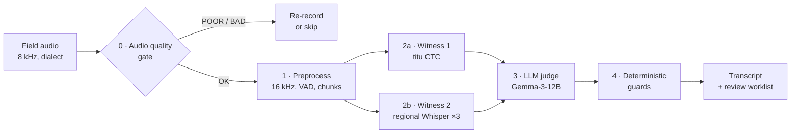

# ASR Pipeline: Bengali Survey Transcription

A fully local, open-source pipeline that turns Bengali survey interviews
(coastal Bangladesh, climate-risk study) into clean transcripts with an English
translation, speaker roles and a short human-review worklist. Everything runs
on one laptop GPU with 8 GB VRAM. No audio, text or translation leaves the
machine.

It is the code behind the presentation in
[`docs/presentation/`](docs/presentation/) (*Fully local AI transcription with
built-in QA*).

---

## Contents

1. [The pipeline](#the-pipeline)
2. [What you get](#what-you-get)
3. [Requirements](#requirements)
4. [Installation](#installation)
5. [Running it](#running-it)
6. [Reproducibility](#reproducibility)
7. [Dependencies and why each is needed](#dependencies-and-why-each-is-needed)
8. [Configuration](#configuration)
9. [Other languages (general path)](#other-languages-general-path)
10. [Repository layout](#repository-layout)
11. [Troubleshooting](#troubleshooting)

---

## The pipeline



| Step | What happens | Where |
|---|---|---|
| **0 · Check** | Each recording is scored 0–100 (SNR, clipping, silence) and flagged EXCELLENT … BROKEN in one Excel report. Broken files are caught before any GPU time is spent. No GPU or token needed. | `scripts/audio_quality_report.py` |
| **1 · Preprocess** | Resample to 16 kHz mono (soxr), Silero VAD finds speech, speech is cut into chunks of ≤ 15 s with 2 s overlap. | `preprocessor.py` |
| **2a · Witness 1: sound** | **titu** FastConformer-CTC transcribes each chunk *acoustically*: faithful to how names, numbers and dialect words sounded; emits word timestamps. | `engines/titu_engine.py` |
| **2b · Witness 2: structure** | **Regional Whisper-medium** transcribes the same chunk *fluently*, returning **3 readings (N-best)** via seeded sampling so the judge sees where it is unsure (*ward* vs *world*). | `fusion.py` |
| **3 · Reconcile** | **Gemma-3-12B** (4-bit, local, temperature 0) reads both witnesses and, in **one call** per segment: reconciles them into one Bengali line, translates it to English, and labels each turn **ENUMERATOR / RESPONDENT** *from what is said*. A segment holding a question *and* its answer is split into two turns. Its reasoning is kept for audit. | `fusion.py`, `config/prompts/bn_survey.yaml` |
| **4 · Guard** | Plain rules, no AI: a number **neither witness heard** → `[unclear]`; text in a **foreign script** (Cyrillic, Devanagari…) → blanked; output that **drifts from both witnesses** → flagged. | `ger_guard.py` |
| **Review** | Only the segments a human should check go to the worklist: any **number**, **witness disagreement**, **`[unclear]`** text, and **split turns**. | `pipeline.py` |

**No voice diarization on this path.** Voice clustering can say *which voice*,
never *which role*; the LLM labels roles from the content. Models load one at a
time (load → use → unload), which is how the whole chain fits in 8 GB.

## What you get

For each interview `name`:

| File | Contents |
|---|---|
| `name.txt` (+ `.json`, `.srt`) | Final transcript: raw ASR → corrected Bengali → English, each turn labelled ENUMERATOR / RESPONDENT |
| `name.review.txt` | **QA worklist**: only the flagged segments, with the reason for each |
| `name.reasoning.txt` | The judge's reasoning, both witnesses and the guard metrics, per segment |
| `name.raw.txt` | The pre-LLM titu transcript, for audit |

```
[00:01:12] ENUMERATOR:
[bn-raw] আপনার খানায় কতজন সদস্য আমার খানায় ছয়জন
[bn] আপনার খানায় কতজন সদস্য?
[en] How many members are in your household?

[00:01:15] RESPONDENT:
[bn] আমার খানায় ছয়জন।
[en] Six, in my household.
```
*(Illustrative lines, invented.)*

## Requirements

### Operating system: Linux (Ubuntu), native or WSL2

The pipeline is developed and tested on **Ubuntu 22.04 / 24.04, x86_64**. On
Windows, use **WSL2 with Ubuntu**. Native Windows is not supported, because
several dependencies only ship working Linux builds:

- **NeMo** (`nemo-toolkit`, runs titu) depends on Linux-only packages and is
  not supported on native Windows.
- The **CUDA build of `llama-cpp-python`** (runs Gemma) is pulled from a
  prebuilt-wheel index that `pyproject.toml` enables only for
  `sys_platform == 'linux'`. Elsewhere you get the CPU build, which is far too
  slow.
- **fairseq2** (used by the optional `omnilingual-asr` extra, general path) ships Linux wheels only.
- The `justfile` recipes are written for bash.

macOS installs the CPU builds; it works for the unit tests but is not
practical for real interviews.

### Hardware

| | Minimum | Notes |
|---|---|---|
| GPU | NVIDIA, **8 GB VRAM** | Validated on an RTX 2000 Ada (8 GB). A 16 GB card makes fusion much faster (batching) and allows Gemma-3-27B. |
| NVIDIA driver | Supports **CUDA 12.8** | PyTorch is installed from the cu128 index. On WSL2, install the *Windows* NVIDIA driver; do **not** install a Linux driver inside WSL. |
| RAM | 16 GB | |
| Disk | ~30 GB free | ~10 GB models + ~15 GB Python environment |

### System tools

| Tool | Why | Install (Ubuntu) |
|---|---|---|
| `git` | clone the repo | `sudo apt install git` |
| `ffmpeg` | decode m4a/mp3, resample | `sudo apt install ffmpeg` |
| `build-essential`, `zlib1g-dev`, `libbz2-dev`, `liblzma-dev` | **Only for the optional multilingual extra:** a C/C++ compiler and headers to build `kenlm` (pulled in by `omnilingual-asr`), which has no prebuilt wheel. The Bengali pipeline does not need them. | `sudo apt install build-essential zlib1g-dev libbz2-dev liblzma-dev` |
| [`uv`](https://docs.astral.sh/uv/) | Python + dependency manager; installs the exact locked versions | `curl -LsSf https://astral.sh/uv/install.sh \| sh` |
| [`just`](https://github.com/casey/just) | task runner (`just fusion …`) | `uv tool install rust-just` |

You do **not** need to install Python yourself: `uv` downloads Python 3.12 (the
version pinned in `.python-version`).

## Installation

**1. (Windows only) Set up WSL2 with Ubuntu.** In an *administrator*
PowerShell:

```bash
wsl --install -d Ubuntu-24.04
```

Restart, open **Ubuntu** from the Start menu, and run everything below inside
it. Keep the repository and your audio **in the Linux file system**
(e.g. `~/asr-pipeline`), not under `/mnt/c/…`. Reading through `/mnt/c` is
much slower, and a synced folder (OneDrive) would try to upload the 15 GB
environment.

Check the GPU is visible from Ubuntu:

```bash
nvidia-smi
```

**2. Install the system tools:**

```bash
sudo apt update && sudo apt install -y git ffmpeg
curl -LsSf https://astral.sh/uv/install.sh | sh
source ~/.bashrc
uv tool install rust-just
```

**3. Clone and install:**

```bash
git clone https://github.com/noureini/asr-pipeline.git ~/asr-pipeline
cd ~/asr-pipeline
just setup
```

`just setup` runs two steps:

- `uv sync --frozen` installs the **exact** package versions in `uv.lock`
  (including the CUDA builds of torch and llama-cpp-python).
- `scripts/download_models.py` downloads titu, regional Whisper and Gemma at
  the **pinned commits** in `fusion_production.yaml` (~10 GB, one time) and
  builds the faster CTranslate2 copy of Whisper in `models/`.

**4. Verify:**

```bash
just test     # unit tests, no GPU or models needed
just gpu      # should print: CUDA available: True
just check    # every runtime dependency imports
```

**5. (Optional) HF token.** Only needed for the per-speaker quality report and
the general multilingual path (pyannote is a gated model):

```bash
cp .env.example .env    # then set HF_TOKEN=hf_...
```

## Running it

```bash
# Step 0 · audio quality report for a folder (no GPU) → quality_report.xlsx
just quality ./interviews

# Steps 1-4 · one interview
just fusion interview.m4a -o ./outputs

# …a whole Survey Solutions export (resume-safe: re-run to continue)
just fusion-folder ./interviews -o ./outputs
```

`just fusion-folder` expects the Survey Solutions layout, and merges each
interview's files into one transcript with absolute timestamps:

```
interviews/
  {interview_key}/
    AudioAudit/
      *.m4a
```

Useful options (append to `just fusion …`): `-o DIR` output folder, `-p NAME`
project name in the header, `-f all` write txt + json + srt, `--log-file FILE`.
The recipes are thin wrappers; the full command is:

```bash
HF_HUB_OFFLINE=1 uv run asr-pipeline transcribe interview.m4a -l ben -c fusion_production.yaml
```

**Speed:** about 6 minutes for a 5-minute clip on an 8 GB GPU. The Gemma step
dominates.

## Reproducibility

Everything that affects the output is pinned:

| What | How it is pinned |
|---|---|
| Python | `3.12` (`.python-version`, `requires-python = ">=3.12,<3.13"`) |
| Every Python package, transitively | `uv.lock`, installed with `uv sync --frozen` |
| PyTorch / torchaudio | `==2.8.0`, CUDA 12.8 builds (matched to fairseq2) |
| titu model | `hishab/titu_stt_bn_fastconformer` @ `993316b` |
| Whisper model | `bengaliAI/tugstugi_bengaliai-regional-asr_whisper-medium` @ `bc519b9` |
| Judge model | `unsloth/gemma-3-12b-it-GGUF` / `gemma-3-12b-it-UD-Q4_K_XL.gguf` @ `d15e4c7` |
| Silero VAD | bundled in the locked `silero-vad` package (no download at run time) |
| Decoding | Gemma greedy (`temperature: 0`); Whisper N-best sampling seeded (`seed: 1234`) |
| Prompts | `config/prompts/bn_survey.yaml`; a unit test keeps it identical to the in-code copy |
| Line endings | `.gitattributes` forces LF |

Model revisions are full commit hashes in `fusion_production.yaml`
(`titu.revision`, `fusion.whisper_revision`, `fusion.gguf_revision`). After
`just setup-models`, runs are fully offline: the `fusion` recipes set
`HF_HUB_OFFLINE=1`. Re-running the same audio with the same config gives the
same transcript on the same hardware. GPU kernels can differ slightly across
GPU models and drivers.

## Dependencies and why each is needed

All are declared in `pyproject.toml` and locked in `uv.lock`.

| Package | Used for |
|---|---|
| **Core runtime** | |
| `torch==2.8.0`, `torchaudio==2.8.0` | Tensor runtime for titu, Whisper (HF fallback), Silero VAD and pyannote; audio loading/resampling. Pinned because fairseq2 and torchaudio must match torch exactly. |
| `nvidia-cudnn-cu12` | cuDNN 9 for CTranslate2 (fast Whisper) on GPU |
| `numpy`, `soundfile`, `librosa` | Audio arrays, file I/O, quality metrics |
| `silero-vad`, `onnxruntime` | Voice-activity detection (Step 1) |
| `noisereduce` | Optional noise reduction (off in production) |
| **Witness 1: titu** | |
| `nemo-toolkit[asr]` | Loads and runs the titu FastConformer-CTC `.nemo` model |
| `onnx<1.19` | NeMo dependency, capped so it stays numpy-1.x compatible (fairseq2) |
| **Witness 2: Whisper** | |
| `ctranslate2`, `faster-whisper` | Fast batched N-best decoding of the CT2 copy of Whisper |
| `transformers`, `accelerate` | Fallback Whisper path, and the HF model loader |
| `huggingface-hub` | Downloads models at pinned revisions; offline cache lookup |
| **Judge: Gemma** | |
| `llama-cpp-python` | Runs the 4-bit GGUF in-process on the GPU (CUDA wheel on Linux) |
| **Quality report** | |
| `openpyxl` | Writes `quality_report.xlsx` |
| `pyannote.audio<4`, `speechbrain` | Per-speaker quality report and the general path's diarization. Pinned < 4 because pyannote 4 needs numpy 2, which fairseq2 does not support yet. |
| **General multilingual path** | |
| `omnilingual-asr` (extra `multilingual`) | ASR for 1,600+ languages. Pulls fairseq2 and kenlm (needs a compiler). Not installed by default. |
| `sentencepiece` | NLLB tokenizer (`ct2_nllb` translation backend) |
| `bitsandbytes` | 4/8-bit loading for the HF translation backends |
| `ollama` | Client for the optional Ollama refinement backend |
| **CLI and config** | |
| `click`, `rich` | Command line and progress display |
| `pydantic`, `pydantic-settings`, `pyyaml`, `python-dotenv` | Validated YAML configuration, `.env` loading |
| **Development** (`--extra dev`) | |
| `pytest`, `pytest-cov`, `ruff`, `mypy` | Tests, coverage, lint, type checks |

To add or upgrade a package: `uv add 'package>=x'` (or edit `pyproject.toml`
and run `uv lock`), run `just test`, and commit both `pyproject.toml` and
`uv.lock`.

## Configuration

The Bengali pipeline is defined by [`fusion_production.yaml`](fusion_production.yaml),
layered on the bundled defaults in
[`src/asr_pipeline/default.yaml`](src/asr_pipeline/default.yaml). The settings
that matter most:

| Setting | Value | Why |
|---|---|---|
| `pipeline.force_engine` | `titu` | Witness 1 for Bengali |
| `diarization.enabled` | `false` | Roles come from the LLM, not voice clustering |
| `alignment.enabled` | `false` | titu's own CTC word timestamps are used directly |
| `fusion.whisper_nbest` | `3` | Three Whisper readings for the judge |
| `fusion.temperature` | `0.0` | Greedy: on near-empty segments sampling invented survey answers |
| `fusion.repeat_penalty` | `1.0` | The llama.cpp default 1.1 drops legitimate repetition in dialect speech |
| `fusion.n_ctx`, `flash_attn`, `kv_quant` | `2048`, on, on | Keeps Gemma + KV cache inside 8 GB (no paging) |
| `fusion.ger_guard` | `true` | Number-abstain, foreign-script and agreement checks |
| `fusion.ger_snap` | `false` | Snap-to-witness stays off until calibrated (`just calibrate-ger name.reasoning.txt`) |

**Prompt.** The judge's instructions (dialect glossary, domain priors, number
rules, role definitions) live in
[`config/prompts/bn_survey.yaml`](config/prompts/bn_survey.yaml). Edit the
YAML, not the code. Keep the in-code copy in `fusion.py` in sync; `just test`
fails if they drift.

**Adapting to another language or survey:** copy `fusion_production.yaml`,
swap the two witnesses for a phonetic (CTC) and a fluent (Whisper-style) model
for your language, and adapt the prompt's glossary and priors. Keep the
number-abstain guard. Validate on 20–30 segments with a native speaker before
scaling.

## Other languages (general path)

For languages other than Bengali, the pipeline uses a single ASR engine
(Whisper large-v3 for high-resource languages, Omnilingual ASR for 1,600+
others), pyannote diarization, and a local LLM for correction/translation.
This path does not have the two-witness fusion or the review worklist.

It is an **optional install** (the `multilingual` extra), because Omnilingual
pulls in `kenlm`, which compiles from source and needs a compiler:

```bash
sudo apt install -y build-essential zlib1g-dev libbz2-dev liblzma-dev
just setup-multilingual        # multilingual extra + Whisper large-v3, Omnilingual, pyannote models (needs HF_TOKEN)
just transcribe interview.m4a swa
uv run --frozen --extra multilingual asr-pipeline list-languages
```

## Repository layout

```
fusion_production.yaml     Bengali production config (pinned models)
config/prompts/            Judge prompt (editable YAML)
src/asr_pipeline/
  cli.py                   `asr-pipeline` command line
  pipeline.py              Orchestration (Steps 1-4, outputs, worklist)
  preprocessor.py          Resampling, VAD, chunking
  engines/                 titu, Whisper, Omnilingual
  fusion.py                Whisper witness, Gemma judge, role-labelled turns
  ger_guard.py             Deterministic guards
  postprocessor.py         GGUF loader; general-path translation backends
  diarization.py, alignment.py   General path only
  default.yaml             Bundled defaults
scripts/
  audio_quality_report.py  Step 0
  download_models.py       Pinned model download + CT2 conversion
  ger_calibrate.py         GER snap-threshold calibration
tests/                     Unit tests (no GPU, no models)
docs/presentation/         The presentation this code implements
```

The research history (A/B scripts, model bake-offs, LoRA and phoneme
experiments, earlier configs and decks) is kept on the
[`archive/experiments`](https://github.com/noureini/asr-pipeline/tree/archive/experiments)
branch and the `v0-pre-cleanup` tag, not on `main`.

## Troubleshooting

| Symptom | Fix |
|---|---|
| `CUDA available: False` in WSL | Update the **Windows** NVIDIA driver; run `nvidia-smi` inside Ubuntu. Don't install a Linux driver in WSL. |
| Gemma is very slow (~4 tok/s) | VRAM is paging. Close other GPU apps; keep `n_ctx: 2048`, `flash_attn: true`, `kv_quant: true`. |
| `LocalEntryNotFoundError` with `HF_HUB_OFFLINE=1` | Models not downloaded yet: run `just setup-models` once with a network. |
| `ffmpeg not found` | `sudo apt install ffmpeg` |
| Install very slow / OneDrive busy | The repo is under `/mnt/c/…`; clone it into `~/` inside WSL instead. |
| `pyannote` 401 / gated | Set `HF_TOKEN` in `.env` and accept the model terms (see `.env.example`). Not needed for `just fusion`. |
